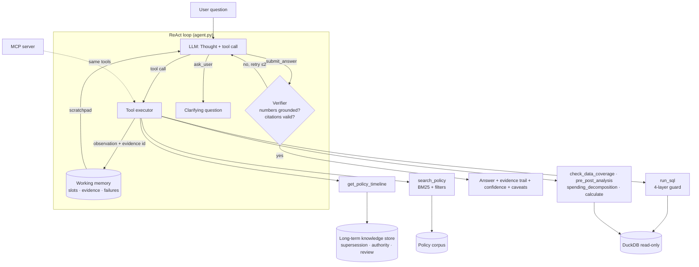

# MedicaidIQ

**A research assistant that connects Medicaid drug-policy changes to utilization data, with citations, reproducible statistics, and stated uncertainty.**

> Capstone project for the CMU *Agentic AI: Building Autonomous Systems for Real-World Applications* program.
> **Status:** Week 2 of 7. Working ReAct agent with tools, short- and long-term memory, guardrails, an MCP server, and an eval harness; 49 passing tests.

## The problem

Medicaid analysts ask questions like:

> *"Did GLP-1 prescribing in Eastvale change after its prior-authorization requirement took effect?"*

Answering correctly takes several steps that a stand-alone LLM gets wrong:

| Step | What goes wrong with prompt-only | What MedicaidIQ does |
|---|---|---|
| Find the effective date | Uses the *announced* date, or a superseded bulletin | Long-term memory resolves supersession and source authority |
| Check the data | Treats missing or lagged quarters as real declines | Coverage check; excludes provisional and missing quarters |
| Compute the change | Arithmetic and statistics errors | Deterministic tools: rates, bootstrap CI, materiality |
| Interpret | Reads spending as care; claims causation | Spending decomposition; association-only guardrail |
| Answer | Unverifiable prose | Structured answer; every number checked against tool output |

**Intended users:** Medicaid policy and analytics professionals, program reviewers, graduate researchers.
**Out of scope:** claims adjudication, eligibility decisions, policy recommendations.

## Architecture



Details: [`docs/architecture.md`](docs/architecture.md). Design history: [`docs/design_log.md`](docs/design_log.md).

## Quick start

Requires Python 3.11+.

```bash
git clone https://github.com/<you>/medicaidiq && cd medicaidiq
python -m venv .venv && .venv\Scripts\activate          # macOS/Linux: source .venv/bin/activate
pip install -e ".[dev]"
medicaidiq build-data                                    # synthetic data, policy corpus, long-term memory
pytest -q                                                # 49 tests, no API key needed
```

### Ask a question (needs an LLM)

Copy `.env.example` to `.env` and set `DEEPSEEK_API_KEY` (or another provider; see below).

```bash
medicaidiq ask "Did GLP-1 prescribing in Eastvale change after its prior authorization requirement took effect?"
medicaidiq ask "Did spending go up after the policy?" --interactive    # answers clarifying questions
```

Each run prints the answer, its evidence trail, tokens, cost, and latency, and saves the full trace to `runs/`.

### Providers

| `MEDICAIDIQ_PROVIDER` | Model | Key |
|---|---|---|
| `deepseek` (default) | `deepseek-flash` | `DEEPSEEK_API_KEY` |
| `qwen` | `qwen-plus` | `DASHSCOPE_API_KEY` |
| `kimi` | `kimi-k2.6` | `MOONSHOT_API_KEY` |
| `local` | any llama.cpp / LM Studio model | none |

Local model on your own GPU ([llama.cpp](https://github.com/ggml-org/llama.cpp/releases) with Vulkan works on AMD and NVIDIA):

```bash
llama-server -m Qwen3-8B-Q4_K_M.gguf -ngl 99 -c 16384 --jinja --reasoning-format deepseek --port 8080
medicaidiq ask "..." --provider local
```

### Evaluate

```bash
python eval/run_eval.py --provider deepseek                    # 9 graded cases
python eval/run_eval.py --provider deepseek --provider qwen    # side-by-side comparison
```

### Use the tools from any MCP host (Claude Desktop, VS Code, Cursor)

```json
{ "mcpServers": { "medicaidiq": { "command": "python", "args": ["-m", "medicaidiq.mcp_server"] } } }
```

## Repository layout

```text
src/medicaidiq/
  agent.py         ReAct loop, stop conditions, verification retries
  tools.py         tool schemas + dispatch (each tool tied to an LLM limitation)
  memory.py        working memory; long-term knowledge store (supersession, conflicts, review)
  stats.py         pre/post with bootstrap CI + materiality, decomposition, coverage, calculator
  db.py            read-only DuckDB + SQL guardrails
  retrieval.py     policy search (BM25 + metadata filters)
  verify.py        grounding/citation verifier
  llm.py           provider-agnostic client, usage & cost metering, scripted LLM for tests
  mcp_server.py    the same tools over Model Context Protocol
  synth.py         synthetic data + policy corpus with planted effects and traps
  evaluation.py    deterministic graders, quality/cost/latency summary
eval/              cases.jsonl, run_eval.py, results/
tests/             49 tests: guardrails, statistics, memory, agent loop, MCP, eval grader
data/synthetic/    generated CSVs + policy documents (fictional states)
docs/              checkpoints, design log, architecture, LLM selection, cost, requirements traceability
```

## Data and privacy

All data is **synthetic** with **fictional states** (Northland, Eastvale, Southport); see [`data/README.md`](data/README.md). The schema mirrors CMS State Drug Utilization Data so that public data can be added later. There is no PHI, no restricted CMS data, and nothing from any employer. Only synthetic or public text is ever sent to an LLM provider.
