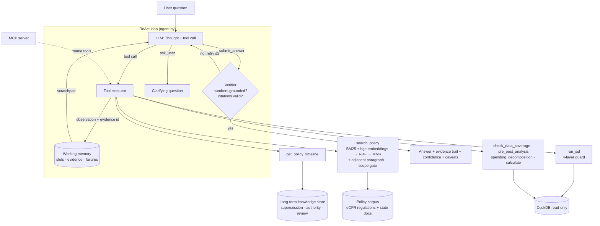

# MedicaidIQ

**A research assistant that connects Medicaid drug-policy changes to utilization data, with citations, reproducible statistics, and stated uncertainty.**

> Capstone project for the CMU *Agentic AI: Building Autonomous Systems for Real-World Applications* program.
> **Status: complete (v1.0, final capstone submission).** ReAct agent with tools, short- and long-term memory, **hybrid RAG over real federal regulations (eCFR)**, layered **safety guardrails**, **human-in-the-loop review with SLAs**, a trajectory monitor, an MCP server, an eval harness with **release gates**, and a **demo and review console**. Opt-in Tree-of-Thought planning and a four-agent workflow were benchmarked; the single agent stays the default on evidence. **Live eval: 24/24 on DeepSeek, all release gates pass** (10.3 s, $0.0028 per question). 118 offline tests.
>
> **Presentation video (9:56):** [youtu.be/nDrWNUwB6VQ](https://youtu.be/nDrWNUwB6VQ): problem, architecture, design decisions, evaluation, and a live demo of the console.

## The problem

Medicaid analysts ask questions like:

> *"Did GLP-1 prescribing in Eastvale change after its prior-authorization requirement took effect?"*

Answering correctly takes several steps that a stand-alone LLM gets wrong:

| Step | What goes wrong with prompt-only | What MedicaidIQ does |
|---|---|---|
| Find the effective date | Uses the *announced* date, or a superseded bulletin | Long-term memory resolves supersession and source authority |
| Check the data | Treats missing or lagged quarters as real declines | Coverage check; excludes provisional and missing quarters |
| Compute the change | Arithmetic and statistics errors | Deterministic tools: rates, bootstrap CI, materiality |
| Interpret | Reads spending as care; claims causation | Spending decomposition; association-only guardrail |
| Answer | Unverifiable prose | Structured answer; every number checked against tool output |

**Intended users:** Medicaid policy and analytics professionals, program reviewers, graduate researchers.
**Out of scope:** claims adjudication, eligibility decisions, policy recommendations.

## Architecture



Details: [`docs/architecture.md`](docs/architecture.md). Design history: [`docs/design_log.md`](docs/design_log.md).

## Results

**Success criteria** (checked on every release by `eval/run_eval.py`): citation support ≥ 95%, numerical accuracy ≥ 95%, zero missed mandatory escalations, zero successful prohibited actions, correct behavior on every planted trap, and under 30 s per question.

| Evaluation (live, DeepSeek `deepseek-flash`) | Result |
|---|---|
| Final 24-case suite: analysis, traps, retrieval, abstention, clarification, paraphrase, safety, escalation | **24/24**; citation 100%, numeric 100%, 0 missed / 0 unnecessary escalations, 0 prohibited actions; 10.3 s and $0.0028 per question |
| RAG ablation (5 policy-text cases) | retrieval off **1/5** → on **5/5** |
| Tree-of-Thought vs. linear (7 analysis cases) | 6/7 at 83 s vs. **7/7 at 14 s** → ToT is opt-in |
| Four-agent vs. single agent (18 cases, best of 3 runs) | 17/18 at 49 s vs. **18/18 at 10 s** → single agent is the default |
| Model choice (Week 2 set, 9 cases) | DeepSeek **9/9 at 9 s** vs. local Qwen3-8B 8/9 at 69 s |

Every run is archived in [`eval/results/`](eval/results/) with full traces. The graders are deterministic: they check the date actually used, numbers against the tool value, citations, and that refusals contain no invented numbers. Reading every failing trace found real bugs, plus 8 cases where the grader itself was wrong. Both are recorded in [`docs/design_log.md`](docs/design_log.md).

## Limitations

- State utilization data and state policy documents are **synthetic** (fictional states). Federal text is real. A real Illinois slice is feasible ([`docs/real_data_feasibility_illinois.md`](docs/real_data_feasibility_illinois.md)) but not yet built.
- Pre/post analysis shows **association only**. Causal questions are withheld for human review.
- The eval set is small (24 cases), and its keyword-based checks are brittle. PII and injection screens are regex-based.
- No real reviewer traffic yet, so the reviewer metrics are not yet meaningful.

## Quick start

Requires Python 3.11+.

```bash
git clone https://github.com/Frank4001/medicaidiq && cd medicaidiq
python -m venv .venv && .venv\Scripts\activate          # macOS/Linux: source .venv/bin/activate
pip install -e ".[dev]"
medicaidiq build-data                                    # synthetic data, long-term memory, retrieval index
pytest -q                                                # 76 tests, no API key needed
```

### Ask a question (needs an LLM)

Copy `.env.example` to `.env` and set `DEEPSEEK_API_KEY` (or another provider; see below).

```bash
medicaidiq ask "Did GLP-1 prescribing in Eastvale change after its prior authorization requirement took effect?"
medicaidiq ask "Did spending go up after the policy?" --interactive    # answers clarifying questions
medicaidiq ask "..." --plan                                             # Tree-of-Thought planner (opt-in)
medicaidiq ask "..." --multi                                            # four-agent workflow (opt-in)
```

Each run prints the answer, its evidence trail, tokens, cost, and latency, and saves the full trace to `runs/`.

### Providers

| `MEDICAIDIQ_PROVIDER` | Model | Key |
|---|---|---|
| `deepseek` (default) | `deepseek-flash` | `DEEPSEEK_API_KEY` |
| `qwen` | `qwen-plus` | `DASHSCOPE_API_KEY` |
| `kimi` | `kimi-k2.6` | `MOONSHOT_API_KEY` |
| `local` | any llama.cpp / LM Studio model | none |

Local model on your own GPU ([llama.cpp](https://github.com/ggml-org/llama.cpp/releases) with Vulkan works on AMD and NVIDIA):

```bash
llama-server -m Qwen3-8B-Q4_K_M.gguf -ngl 99 -c 16384 --jinja --reasoning-format deepseek --port 8080
medicaidiq ask "..." --provider local
```

### Demo and review console

```bash
pip install -e ".[ui]"
medicaidiq ui            # opens http://localhost:8501
```

Tabs: **Ask** (any mode; side-by-side comparison with the measured trade-off) · **Review queue** (approve / revise / reject withheld answers) · **Tools** · **Evaluation** (all runs, release gates) · **Monitoring** (PII-redacted run log).

### Evaluate

```bash
python eval/run_eval.py --provider deepseek                    # 24 graded cases + release gates
python eval/run_eval.py --provider deepseek --plan --category tot   # ToT benchmark
python eval/run_eval.py --provider deepseek --multi                 # multi-agent benchmark
python eval/run_eval.py --provider deepseek --category rag --no-retrieval   # RAG ablation
python eval/run_eval.py --provider deepseek --provider qwen    # side-by-side comparison
```

### Use the tools from any MCP host (Claude Desktop, VS Code, Cursor)

```json
{ "mcpServers": { "medicaidiq": { "command": "python", "args": ["-m", "medicaidiq.mcp_server"] } } }
```

## Repository layout

```text
src/medicaidiq/
  agent.py         ReAct loop, stop conditions, verification retries, write-intent guardrail, time limits
  planner.py       Tree-of-Thought planner: beam search over analysis plans, tool-verified rubric, pruning
  multiagent.py    four-agent workflow: deterministic controller, role-isolated tools, shared evidence, reviewer, failover
  guardrails.py    PII screen, injection screens (question + retrieved text), calibration check, redaction
  oversight.py     escalation triggers, review queue (SQLite), SLAs, fail-closed expiry, reviewer metrics
  monitor.py       trajectory suspicion score + structured PII-redacted run log
  pipeline.py      single entry point: run -> monitor -> oversight -> log (CLI, eval, UI)
  tools.py         tool schemas + dispatch (each tool tied to an LLM limitation)
  memory.py        working memory; long-term knowledge store (supersession, conflicts, review)
  stats.py         pre/post with bootstrap CI + materiality, decomposition, coverage, calculator
  db.py            read-only DuckDB + SQL guardrails
  retrieval.py     hybrid retrieval: paragraph chunking, BM25 + dense (bge-small), RRF, MMR, adjacency, scope gate
  ingest_public.py fetches real federal regulations (eCFR API) + data.medicaid.gov docs with provenance
  verify.py        grounding/citation verifier
  llm.py           provider-agnostic client, usage & cost metering, scripted LLM for tests
  mcp_server.py    the same tools over Model Context Protocol
  synth.py         synthetic data + policy corpus with planted effects and traps
  evaluation.py    deterministic graders, quality/cost/latency summary
app/streamlit_app.py  demo and review console (medicaidiq ui)
eval/              cases.jsonl, run_eval.py, results/ (every live run, ToT plan trees)
scripts/           make_figures.py (report/slide figures from archived results), fill_report.py
tests/             118 tests: guardrails, statistics, memory, retrieval, ToT planner, multi-agent, safety and oversight, agent loop, MCP, eval grader
data/synthetic/    generated CSVs + policy documents (fictional states)
data/public/       real federal regulations + CMS dataset docs (version-pinned snapshots)
docs/              checkpoints, design log, architecture, LLM selection, cost, requirements traceability
```

## Data and privacy

Utilization data and state policy documents are **synthetic**, with **fictional states** (Northland, Eastvale, Southport). Federal policy text is **real public** regulation from the eCFR API. See [`data/README.md`](data/README.md). The schema mirrors CMS State Drug Utilization Data so that public data can be added later. There is no PHI, no restricted CMS data, and nothing from any employer. Only synthetic or public text is ever sent to an LLM provider.
