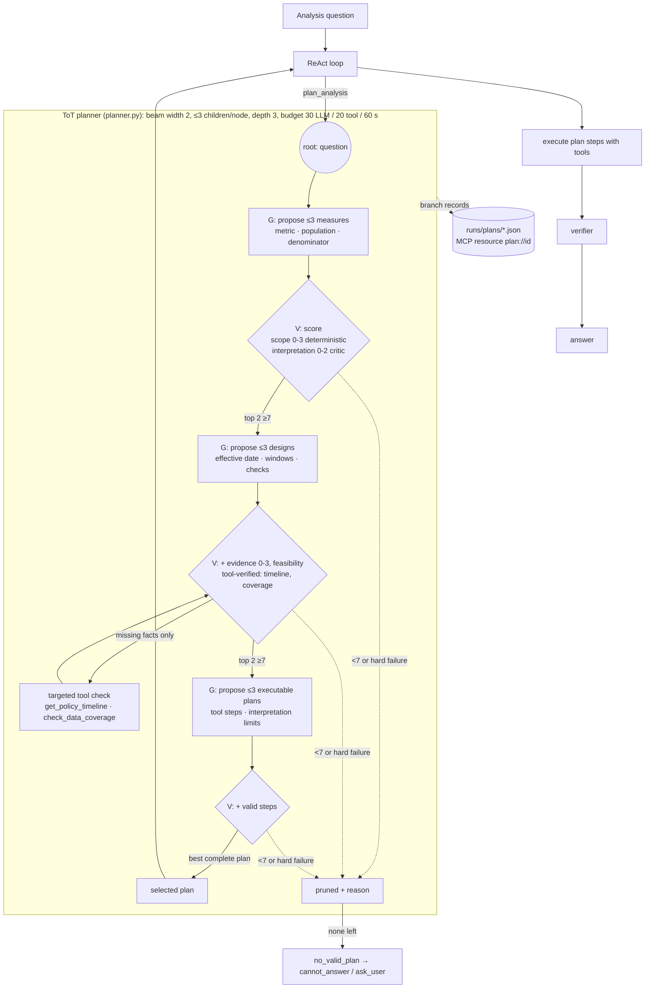

# Architecture (as of Week 3)

## Components

| Component | File | Responsibility | Course concept |
|---|---|---|---|
| ReAct controller | `agent.py` | Thought → tool call → observation loop; stop conditions; verification retries; clarification handoff | Reasoning loops (M2) |
| LLM client | `llm.py` | One OpenAI-compatible client for DeepSeek, Qwen, Kimi, or local; token, cost, and latency metering | Model selection: quality × cost × latency (M1) |
| Tools | `tools.py`, `stats.py`, `db.py` | Grounded facts and exact computation; each tool is tied to a named LLM limitation | Tool use (M2) |
| Retrieval (RAG) | `retrieval.py`, `ingest_public.py` | Paragraph chunks of eCFR regulations + state documents; BM25 + bge-small dense → RRF → MMR → adjacent paragraph; jurisdiction filter; relevance and scope gate; paragraph-level citations | RAG, DPR, MMR (M3) |
| Working memory | `memory.py` (`WorkingMemory`) | Slots, numbered evidence, failed attempts; scratchpad re-injected each step | Short-term memory (M2) |
| Knowledge store | `memory.py` (`KnowledgeStore`) | Provenance-tracked facts; supersession; authority-based conflict resolution; staleness review; human approval | Long-term memory (M2) |
| Verifier | `verify.py` | Checks numbers are grounded and citations are valid before an answer is released | Output monitoring / guardrails (M1–M2; expanded M5–6) |
| Guardrails | `db.py`, `agent.py`, tool schemas | SELECT-only + table allowlist + read-only connection + row and time limits; write-intent refusal before any LLM call; unparseable answers rejected | Least privilege (M1 MCP) |
| MCP server | `mcp_server.py` | Exposes tools, resources, and prompts to any MCP host | MCP (M1–M2) |
| Eval harness | `evaluation.py`, `eval/` | Deterministic graders; pass rate, cost, latency, and consistency | Evaluation (M1, M6) |

## One question, step by step

*"Did GLP-1 prescribing in Eastvale change after its prior authorization requirement took effect?"*

*(Illustrative: the thoughts are paraphrased, and the observations are real outputs of the tools on the synthetic data. Live LLM traces will be added to `eval/results/` once validation runs.)*

| Step | Thought (model) | Action | Observation (abridged) |
|---|---|---|---|
| 1 | Need the authoritative effective date | `get_policy_timeline(EV, glp1_prior_auth)` | 2024-07-01 from EV-MAN-2024-PH; **superseded:** EV-BUL-2024-007 said 2024-06-01 |
| 2 | Need to know which quarters are usable | `check_data_coverage(EV)` | 2025Q3–Q4 provisional |
| 3 | Run the comparison with the resolved date | `pre_post_analysis(EV, GLP1, 2024-07-01)` | −18.6% (95% CI −20.8 to −16.2), significant_and_material |
| 4 | Ready to answer | `submit_answer(...)` | Verifier: all numbers grounded, citations E1–E3 valid → released |

The answer states the change, the CI, that the result is an association and not proof of causation, that the dates came from the superseding bulletin, that the data is synthetic, and what a human should verify.

## Stop conditions

| Condition | Outcome |
|---|---|
| `submit_answer` passes verification | `answer`, `cannot_answer`, or `clarification_needed` returned |
| Write-intent request (delete/insert/alter data) | `cannot_answer` from the guardrail, with no model call |
| Unparseable `submit_answer` | Rejected; model asked to resubmit (counts as a step) |
| Verification still failing after 2 retries | Answer released with an explicit "verification did not fully pass" caveat |
| `ask_user` in non-interactive mode | `clarification_needed` with the question |
| Same tool call fails 3 times in a row | `cannot_answer`, with the failed attempts listed |
| 10 steps | `cannot_answer`, with the reason given |

## Planned additions

- **Later weeks:** coordination and planning (per the course modules), richer guardrails and monitoring, human-oversight workflow, a larger eval set and results.

## Week 4: Tree-of-Thought analysis planner

ToT is a **tool** (`plan_analysis`), offered only when planning is enabled (`--plan`). The ReAct loop decides when to call it, and the system prompt limits it to before/after, spending-change, and period-comparison questions. Lookups and policy-text questions never enter the tree.

| ToT role | Implementation |
|---|---|
| Thought generator | `ToTPlanner._expand`: one "propose" call per parent (Lab 4.1), JSON mode |
| Critic / evaluator | Deterministic checks for scope, evidence, and feasibility via real tool calls (`_deterministic`, `_targeted_evidence_checks`); LLM critic (`_critic`) only for interpretation |
| Decision maker / controller | `ToTPlanner.plan`: beam selection, prune < 7, hard-failure override, tie-break (evidence → scope → fewer steps), budget |
| Memory / state manager | `PlanNode` records (id, parent, depth, plan, score, breakdown, status, prune reason) persisted per run; readable over MCP (`plan://{plan_id}`) |
