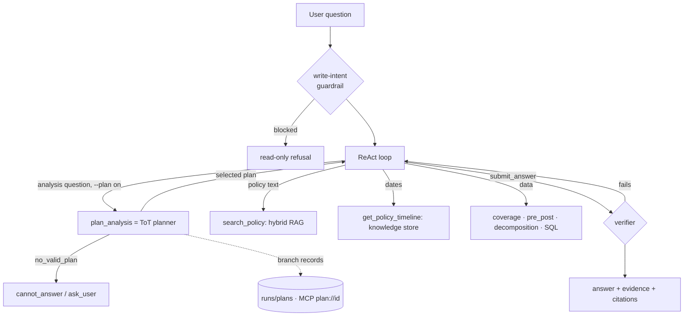

# Week 4 Checkpoint: Tree-of-Thought Integration

**Module 4 learning outcome:** Integrate Tree-of-Thought (ToT) reasoning into the capstone agent design using CrewAI, LangChain, and MCP.

Checkpoint 4.1 proposed ToT for choosing an analysis plan (beam width 2, depth 3, a 10-point rubric, prune below 7). This week that design was **built, tested, and benchmarked against the linear agent on DeepSeek**. The result changed the design: ToT is kept as an opt-in planner, not the default path. This document follows the seven rubric criteria.

---

## 1. Where ToT is used, and why linear reasoning could fail there

**Where:** choosing *how* to analyze a before/after, spending-change, or period-comparison question, before any analysis runs. It is implemented as the tool `plan_analysis` (`src/medicaidiq/planner.py`), which the ReAct loop calls first for those question types. Lookups and policy-text questions (RAG) never enter the tree.

**Why linear chain-of-thought could fail there** (premature commitment, as in Lab 4.1 where ~60% of CoT failures happen at step 1). Each of these is a planted trap in our data:

| Early commitment | Consequence | Trap / eval case |
|---|---|---|
| Uses the **announced** date ("announced in May 2024") | Wrong pre/post windows | Eastvale bulletin, superseded: `tot_announced_date` |
| Uses the **lower-authority** date | Wrong windows; conflict hidden | Northland manual vs. SPA: `conflict_nl` |
| Compares **raw counts** | Enrollment growth looks like more care | Southport: `tot_raw_vs_rate` |
| Treats **spending** as utilization | Price or enrollment effects misread | `tot_spending_driver`, `decomp_sp` |
| Compares a **provisional** quarter | Claims lag looks like a decline | Eastvale 2025Q4: `tot_provisional_window` |

## 2. ToT structure

| Element | Definition |
|---|---|
| **Thought / state** | A structured analysis-plan proposal (JSON), refined level by level. A node holds the plan so far, its score breakdown, hard failures, critic note, and status |
| **Depth 1** | Measure and population: `question_type`, `state`, `drug_class`, `metric`, denominator rationale, ≤ 2 assumptions |
| **Depth 2** | Comparison design: `effective_date` + `date_source`, `comparison` (pre/post with window, or two quarters), required checks |
| **Depth 3** | Executable plan: ordered tool `steps` + `interpretation_limits` |
| **Branch** | A different analytical choice at a level (another metric, date, or window) |
| **Branching factor** | ≤ 3 children per node ("propose" strategy: one LLM call returns all three) |
| **Depth limit** | 3 |
| **Size bound** | 3 + 2×3 + 2×3 = **15 nodes** maximum |
| **Termination** | Depth 3 reached → select the best complete plan that passes all checks; **or** budget exhausted; **or** no surviving candidates → `no_valid_plan`, and the agent answers `cannot_answer` or asks the user |

## 3. Evaluation and pruning

**10-point rubric.** Deterministic, tool-verified checks wherever possible (Lab 4.1's "Python-backed verification"). The LLM critic is used only where judgment is needed:

| Criterion | Points | Evaluated by | What is checked |
|---|---|---|---|
| Scope alignment | 0–3 | **Deterministic** | State has data; drug class exists; metric exists and fits the question (spending question → spending metric) |
| Evidence support | 0–3 | **Deterministic + tool calls** | Effective date equals the authoritative date from `get_policy_timeline` (2 pts); the date source is cited (1 pt) |
| Feasibility | 0–2 | **Deterministic + tool calls** | Windows contain ≥ 2 **final** quarters per side (from `check_data_coverage`); a policy question needs a multi-quarter design; every step is a real tool with its required arguments |
| Interpretation limits | 0–2 | **LLM critic** | The metric answers the actual question; no causal overclaim; data limits disclosed |

- **Partial plans** are scored only on the criteria that apply at their depth, normalized to 10.
- **Prune below 7.**
- **Hard failures prune regardless of score:** unknown state, unavailable metric, **superseded or lower-authority date**, a non-final quarter in the comparison, fewer than 2 final quarters per side, invalid tool step.
- **Ties:** evidence, then scope, then fewer steps (lower tool cost).

Observed live (`eval/results/plan_trees/*.json`, copied from `runs/plans/`): the checks hard-failed Northland's lower-authority manual date (2024-02-01), Eastvale's superseded June 1 date, every plan that compared provisional 2025Q4, and invented metrics the generator proposed (`glp1_users_per_1000_mm`, `total_rx`, `glp1_share_of_diabetes_fills`).

## 4. Search strategy: beam search, width 2

| Option | Fit for this task |
|---|---|
| BFS (all children at every level) | 3 + 9 + 27 nodes: 3–4× the calls for little gain; each LLM call costs ~5–10 s |
| DFS | Can sink the budget into one weak design (e.g., a raw-count plan) before backtracking |
| Monte Carlo sampling | Needs many rollouts to stabilize, and our plans need hard constraint checks, not averaging |
| **Beam (b = 2)** ✅ | Keeps one alternative alive without exploding; bounded at 15 nodes; fits a shallow (depth 3), constraint-heavy tree, like the paper's Game of 24 setup |

**Compute, latency, and cost bounds:**
- **Budget:** 30 model calls, 20 tool calls, 60 s per planning run.
- **Typical use (measured):** 5–7 model calls and 2 tool calls.
- **Per-call timeout:** derived from the remaining budget, so a network failure degrades the search instead of hanging it.

## 5. ToT roles mapped to implementation tools

| Role | Proposed in Checkpoint 4.1 | **Implemented** | Why |
|---|---|---|---|
| Thought generator | CrewAI planning agent | `ToTPlanner._expand`: a role-specific system prompt plus JSON mode, over our provider-agnostic client | Same role separation without another agent runtime |
| Critic / evaluator | CrewAI reviewer + validation tools | Deterministic checks through real MCP-exposed tools (`get_policy_timeline`, `check_data_coverage`) + `ToTPlanner._critic` (a separate critic prompt) | Most of the rubric is checkable by code. The LLM judges only interpretation |
| Decision maker / controller | Python beam search connected by LangChain / LCEL | `ToTPlanner.plan`: plain Python beam search, pruning, ties, budgets | The control flow is about 60 lines of explicit code, and LCEL wouldn't simplify it |
| Memory / state manager | SQLite through an MCP server | `PlanNode` branch records (id, parent, depth, plan, score, breakdown, status, prune reason) persisted to `runs/plans/{plan_id}.json` and **served by the MCP server as `plan://{plan_id}`** | Explicit branch tracking, readable by any MCP host |

**Design change from Checkpoint 4.1: CrewAI and LangChain were evaluated and not adopted.** The roles are implemented natively in the existing harness, and **MCP is used as planned** for tools and branch-state access. Reasons:
1. Week 4's harness lab (and Anthropic's *Building Effective Agents*, which it cites) advises keeping scaffolding as simple as the task allows. The whole ToT controller is one small, testable module.
2. The agent already has a provider-agnostic tool loop (D2.5). A second framework would duplicate it and add dependency and version risk (MCP itself had a breaking 2.x rename this term).
3. Native code made the failure analysis in §7 possible: every branch, score, and pruning reason is inspectable.

How the same roles would map if a framework were required:
- **CrewAI:** `Agent(role="Planner")`, `Agent(role="Critic")`, with `Task`s per depth.
- **LangChain:** a `RunnableLambda` beam step inside an LCEL chain.
- The MCP tools and resources stay the same either way, so this remains a swap-in option.

## 6. Updated architecture

The ToT internals (generate → evaluate → targeted checks → prune → beam, per depth) are drawn in [`docs/architecture.md`](../architecture.md#week-4-tree-of-thought-analysis-planner).

## 7. ToT failure modes, observed live, and mitigations

The planner was benchmarked against the linear agent on 7 analysis questions (4 ToT trap cases + 3 earlier analysis cases), live on DeepSeek. Three runs were needed, and the first two failed in instructive ways:

| Run | Pass | What went wrong | Mitigation added |
|---|---|---|---|
| ToT v1 | 4/7 | **Empty generations:** depth-2 proposals used the whole 1,800-token output budget before writing any JSON (`finish=length`, `content=''`), so the tree never grew | Larger output budget; concise-output instructions; **one retry with a brevity nudge**, counted in the budget |
| ToT v2 | 4/7 | **Ungrounded generation → premature pruning:** the generator proposed effective dates before any evidence was gathered (it guessed 2024-04-01 or 2024-05-01), the checks correctly scored them 0, and **the whole beam was pruned**. One case also hung for 49 minutes on a network error | **Ground before generating:** after depth 1, fetch the verified policy timeline and data coverage for surviving branches, so depth-2 proposals use real facts (as in the Checkpoint 4.1 workflow: evidence first, then ToT). **Hard time limits:** per-call timeouts from the remaining budget, plus a 240 s per-question limit in the agent |
| **ToT v3** | **6/7** | **Budget exhaustion:** 2 of 7 searches hit the 60 s budget. One agent recovered; the other called the planner twice and then used a non-authoritative date | Bounded by design (the budget held). Raising it would make latency worse |

**The main risk for this project is "weak evaluation signals leading to pruning the best branch."** v2 showed it exactly. The mitigation is two-part:
1. **Ground generation in verified facts**, so good branches exist at all (Lab 4.1: generation quality is the bottleneck).
2. **A targeted evidence check before pruning** any branch whose only weakness is missing information.

### Benchmark: does ToT pay for itself?

| Same 7 questions, DeepSeek `deepseek-flash` | **Linear ReAct (default)** | ReAct + ToT planner |
|---|---|---|
| Passed | **7/7** | 6/7 |
| Average / max latency | **14.0 s / 19.4 s** | 83.1 s / 162.6 s (**5.9×**) |
| Cost (7 questions) | **$0.025** | $0.134 (**5.4×**) |
| Average prompt tokens | 17.0k | 31.5k |

**Interpretation.** ToT works as designed: every completed search picked the correct, verified plan, and it rejected every trap. But it does not beat the linear agent here, because **the traps ToT searches over are already settled deterministically by earlier design decisions**:
- authoritative dates come from the knowledge store (D2.8);
- usable quarters come from the coverage check (D1.11);
- rates vs. counts and spending decomposition are separate tools (D1.2).

So the linear agent rarely commits prematurely, and ToT adds ~6× latency with no accuracy gain. Lab 4.1 asked "when is it worth the compute?" Here, it isn't, at least on this question set with this model.

**Decision (D4.1):** keep ToT **opt-in** (`--plan`), not the default.

**When to revisit:**
- open-ended analysis questions without a single right design (e.g., choosing comparison states for a difference-in-differences analysis);
- weaker models, where a linear agent errs more;
- real data with real ambiguity (Illinois FFS vs. MCO splits).

## 8. Week 4 harness lab: how MedicaidIQ maps to the six components

| Harness component | MedicaidIQ |
|---|---|
| System prompt | `prompts.py`, byte-stable for caching |
| Tool suite | 9–10 small, orthogonal tools with schemas; formatted for the model, with structured JSON observations (the ACI point from SWE-agent) |
| Agent loop | `agent.py`, native tool calling; stops on `submit_answer`, clarification, guardrail, step limit, time limit, or repeated failure |
| Context management | Observation truncation (6,000 chars) + re-injected working-memory scratchpad |
| Permission gate | Read-only DB connection + SQL validator + deterministic write-intent refusal before any LLM call; human approval required for knowledge-store interpretations |
| Execution environment | Local, read-only DuckDB; tools run in process; MCP server for external hosts |
| Observability | Full traces in `runs/` and `eval/results/`, ToT branch records in `runs/plans/`, token, cost, and latency per run |

## 9. Results summary

| | Week 3 | Week 4 |
|---|---|---|
| Eval cases | 14 | **18** (+4 ToT traps) |
| Default config (linear), DeepSeek | 14/14 | **18/18** (9.4 s, $0.0025 per question) |
| ToT config, 7 analysis cases | — | 6/7 (83 s, ~$0.019 per question) |
| Offline tests | 76 | **87** |
