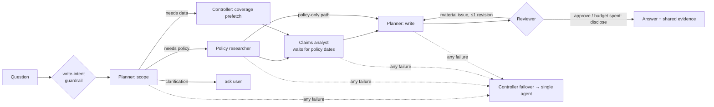

# Week 5 Checkpoint: Multi-Agent Architecture and Coordination

**Module 5 learning outcome:** specify agent roles, a coordination strategy, and a communication approach for a multi-agent workflow.

Checkpoint 5.1 proposed four agents (planner, policy researcher, claims analyst, reviewer) in a hybrid workflow. This week the design was **built, tested, and benchmarked live against the single agent on all 18 eval cases**, and the three grader questions are answered with code and data. As with ToT in Week 4, the result changed the design: the four roles stay, but the default runs them inside one agent, and the multi-agent workflow is opt-in (`--multi`).

---

## 1. Problem, and why a multi-agent design was considered

MedicaidIQ questions mix three different kinds of work:
- **policy evidence:** which date is authoritative, and what a document says;
- **data analysis:** coverage, rates, pre/post comparisons, spending decomposition;
- **result review:** does the answer overclaim, use the wrong jurisdiction, or hide a conflict?

Separating them promises to trace each error to its stage, keep each agent's tools and context small, run independent work in parallel, and add an independent check before release.

## 2. Architecture: 4 LLM agents + a deterministic controller (`src/medicaidiq/multiagent.py`)

| Agent | Responsibility | Tools it can use |
|---|---|---|
| **Controller** (code, no LLM) | Routes stages, runs the parallel phase, enforces the revision cap and time limits, **fails over to the single agent** if any stage breaks | (runs `check_data_coverage` prefetch) |
| **Planner** | Scopes the question (states, drug class, which specialists are needed; asks for clarification if essentials are missing), then **writes the final answer** from the team's evidence | `submit_answer` only |
| **Policy researcher** | Authoritative dates (incl. superseded and conflicting versions) and policy text with chunk citations | `search_policy`, `get_policy_timeline` |
| **Claims analyst** | Coverage, per-member rates, pre/post with CI, spending decomposition, using the researcher's dates | `check_data_coverage`, `run_sql`, `pre_post_analysis`, `spending_decomposition`, `calculate` |
| **Reviewer** | Checks the **draft answer only** for material problems (jurisdiction, superseded date, provisional data, causal overclaim, unsupported claims, undisclosed conflicts) | none (JSON verdict) |

Tool isolation is enforced in code: each sub-agent is offered only its own tools (`test_sub_agents_only_see_their_own_tools`).

## 3. Coordination strategy: a hybrid graph

- **Parallel phase:** the researcher (LLM, slow) runs in a thread while the controller prefetches data coverage (fast, deterministic).
- **Dependency:** the analyst waits for the researcher, so the analysis always uses the authoritative date.
- **Short paths:** policy-only questions skip the analyst; questions about states with no data skip it too.
- **Bounded iteration:** at most 1 reviewer-triggered revision. If an issue is still unresolved, it is **disclosed as a caveat**, not looped (Lab 5.1's retry cap).

## 4. Communication approach

| Channel | Direction | Content |
|---|---|---|
| **Shared evidence store** (`WorkingMemory`, the blackboard) | All agents write; everyone reads | Every tool result gets a global ID (E1, E2, …). The final answer must cite them, and the grounding verifier checks numbers against them |
| Scope → specialists | One-way | Structured JSON (states, drug class, needs_policy, needs_data) |
| Researcher → analyst → planner | One-way | Structured handoff (`summary`, `findings` with evidence IDs, `caveats`) + **the retrieved passage text itself** (added after a live failure, §6) |
| Reviewer ↔ planner | **Two-way**, one round | JSON issues (severity, issue, fix) → targeted revision |

## 5. Answers to the grader's feedback on Checkpoint 5.1

**(a) Why four agents? What is lost by merging the researcher and the analyst?** The *roles* earned their place: separate prompts and tool sets made each sub-agent's job clear, and the trace shows which role made which error. But the benchmark (§6) shows that **running them as separate agents costs accuracy and ~4× latency** compared with one agent that holds all the tools. Each handoff is a new failure point:
- a lossy summary (the writer saw citation labels without the text);
- a mis-scoped state (state *names* were mis-parsed, so a known state was treated as having no data);
- a paraphrased citation.

The single agent has none of these interfaces. **Answer: four roles, executed by default as one agent; the four-agent workflow is opt-in.** Merging loses role-level tracing and parallelism, but at this task size those benefits are smaller than the handoff losses.

**(b) The reviewer's two jobs.** Resolved by splitting them:
- **plan scoring** belongs to the ToT critic (Week 4, opt-in);
- the **reviewer only checks the final draft**.

That also removes a conflict of interest: the same agent no longer scores the plan and then approves the result of that plan.

**(c) If the controller fails.**
- The controller is **deterministic code**: no LLM can derail routing.
- Any exception in any stage triggers **failover to the single agent** (`controller_failover` in the trace; `test_controller_failure_fails_over_to_single_agent`).
- An unparseable scope degrades to "needs policy + needs data"; an unparseable review is treated as approval with a note.
- There is a **time limit for the whole workflow** (300 s), and each sub-agent and model call is bounded (D4.6).

## 6. Benchmark: multi-agent vs. single agent (18 cases, DeepSeek, same graders)

| Run | Pass | Avg / max time | Cost per question | What it found |
|---|---|---|---|---|
| **Single agent (default)** | **18/18** | **9.8 s / 28.9 s** | **$0.0025** | — |
| Multi-agent v1 | 12/18 | 42.7 s / 100.9 s | $0.0126 | 2 grader blind spots (only the last pre/post date checked; doc IDs read as numbers); 3 real **handoff** failures (writer saw summaries only; paraphrased IDs; padded an Illinois refusal with Eastvale's rules) |
| Multi-agent v2 (handoff fixes) | 13/18 | 40.0 s / 92.3 s | $0.0114 | Fixes worked (passage text, exact IDs, no other-state facts), but a **controller bug**: state names ("Northland") were truncated to "NO" and treated as unknown, so the analyst was skipped (2 failures). Plus 2 grader keyword misses ("diverge", bare "42 CFR") and 1 prose turn |
| **Multi-agent v3 (scope fix)** | **17/18** | 49.4 s / 102.1 s | $0.0137 | All v1/v2 failures fixed. Remaining failure is another **lossy handoff**: the writer received a truncated one-line summary of the Southport coverage check and concluded the quarters "cannot be established". The run was also over-scoped (5 policy searches and 9 calculator calls for a coverage question) |

**Interpretation.** At its best (v3), multi-agent **matched** the single agent's accuracy within one case but **never exceeded it**, at **5× latency and 5.5× cost**. Every fix closed one handoff failure, and new interface failures appeared elsewhere, while costing ~4× latency and ~4.5× money. This matches Lab 5.1's rule of thumb: *"Add adaptive control only when you can measure the quality improvement it provides. Start simple, benchmark, then add complexity."* It also matches Week 4's ToT result: **when deterministic tools already settle the hard decisions, adding agents adds failure surface faster than it adds accuracy.**

**Decision (D5.1):** single agent with role-structured tools is the default; `--multi` stays available, tested, and documented.

**When to revisit:**
- much larger corpora, where a researcher's context isolation matters;
- independent multi-state questions that truly parallelize;
- a human-review step, where an independent reviewer has real value.

## 7. Lab 5.2 (fine-tuning) decision: adapt with tools and RAG, not weights

| Option | Fit for MedicaidIQ |
|---|---|
| DAPT on Medicaid text | Policies change and are state- and version-specific. Baking them into weights makes **supersession impossible to track** and stale facts invisible; RAG + the knowledge store update by adding a document |
| LoRA / instruction tuning | Could improve tool-call formatting for a small local model (Qwen3-8B), but DeepSeek already reaches 18/18; we'd need hundreds of labeled traces; 8 GB VRAM limits training |
| **Chosen: tools + RAG + prompts** | Facts stay citable and versioned; numbers come from deterministic tools; swapping models is a config change. Fine-tuning remains a possible lever **only** for the local-model backup (see the deferred local-model plan in `CLAUDE.md`) |

## 8. Other Week 5 changes

- Agents accept a role prompt, a tool subset, and a shared evidence store (`MedicaidIQAgent(system_prompt=…, allowed_tools=…)`, `run(question, memory)`); the evidence store is thread-safe.
- Grader fixes: the date check accepts the authoritative date even when sensitivity runs follow; document IDs, CFR section numbers, and bare "42 CFR" are not numeric claims; more contrast synonyms. These are the 5th–7th grader blind spots found by inspecting traces, which strengthens the case for a sturdier grading method in Week 6.
- Tests: 97 (+10).
